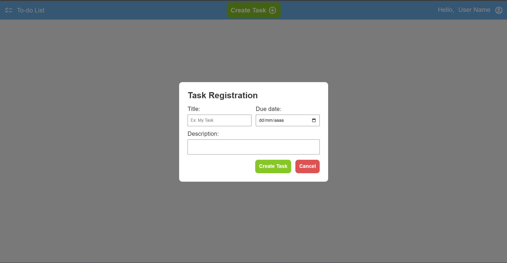

# To-do List App

A task planning app built with Angular and TypeScript, designed to help organize daily commitments with a clean interface and intuitive workflow.

> **Project status:** This application is under development. The task registration screen is currently a UI form; task creation and persistence are not yet implemented.

## Screenshots

### Task creation form



## Features

- Angular single-page application with client-side routing
- Home and **Create Task** navigation
- Task registration form with title, description, and due date fields
- SCSS styling and Material Symbols icons

## Tech stack

- Angular 22
- TypeScript
- SCSS
- RxJS

## Getting started

### Prerequisites

- [Node.js](https://nodejs.org/) and npm

### Install dependencies

```bash
npm install
```

### Run the development server

```bash
npm start
```

Open [http://localhost:4200](http://localhost:4200) in your browser. The app reloads automatically when source files change.

## Available scripts

| Command | Description |
| --- | --- |
| `npm start` | Start the Angular development server. |
| `npm run build` | Create a production build in `dist/`. |
| `npm run watch` | Build in development mode and rebuild when files change. |
| `npm test` | Run unit tests. |

## Project structure

```text
src/
├── app/
│   ├── task/                 # Task registration screen
│   ├── template/             # App layout and navigation
│   ├── app.routes.ts         # Client-side routes
│   └── app.config.ts         # Application configuration
├── index.html
└── styles.scss               # Global styles
```
